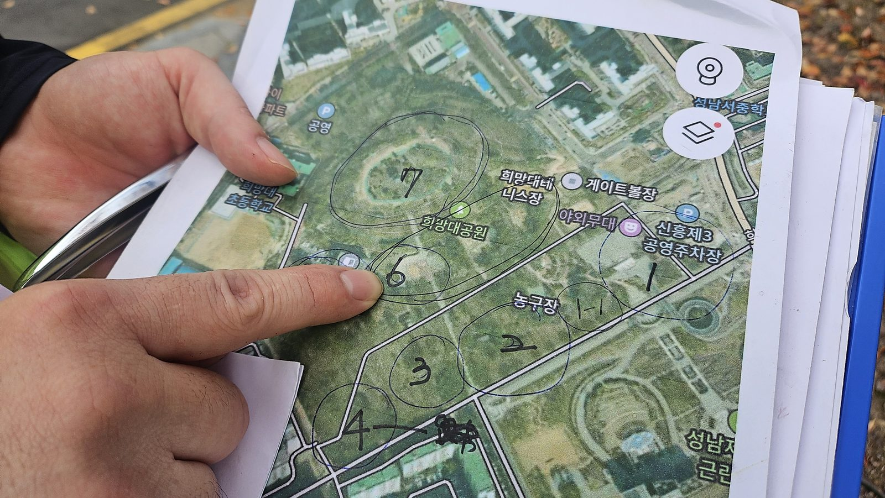
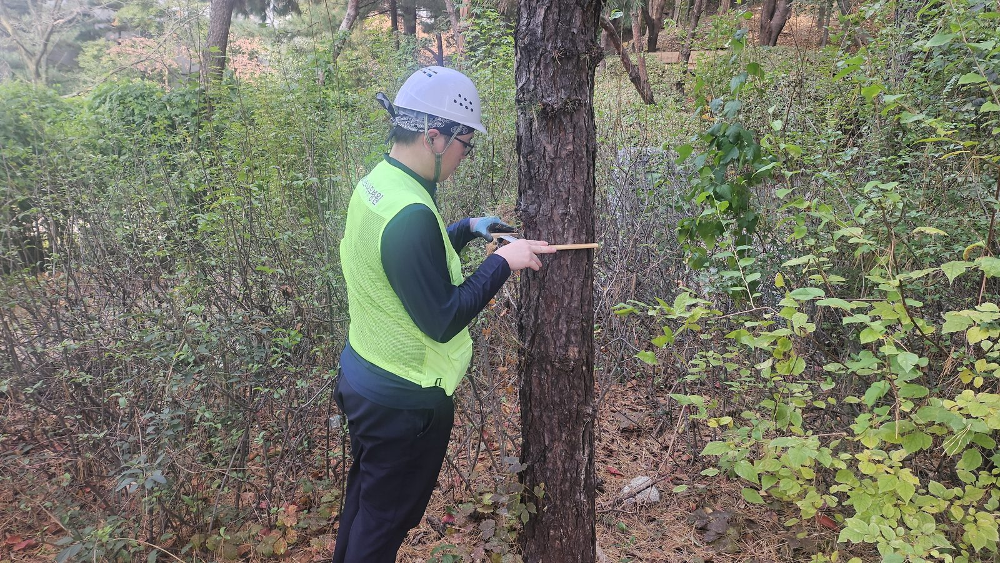
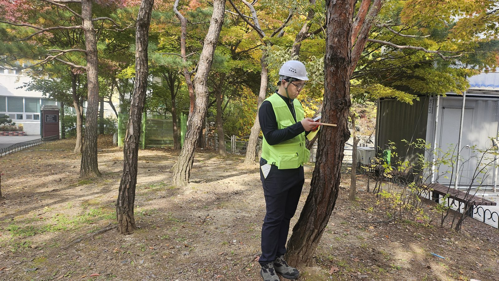
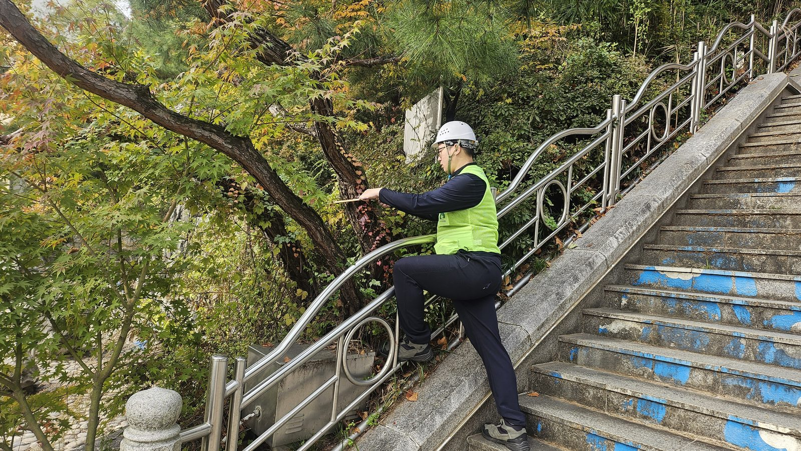
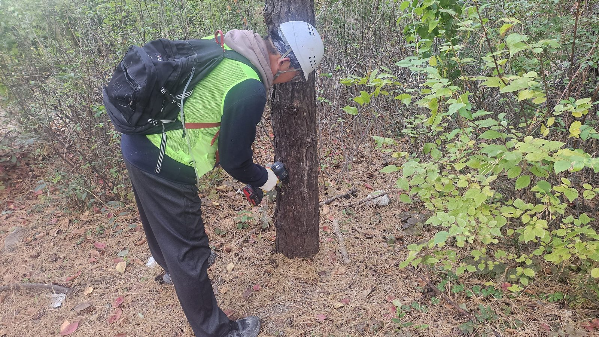
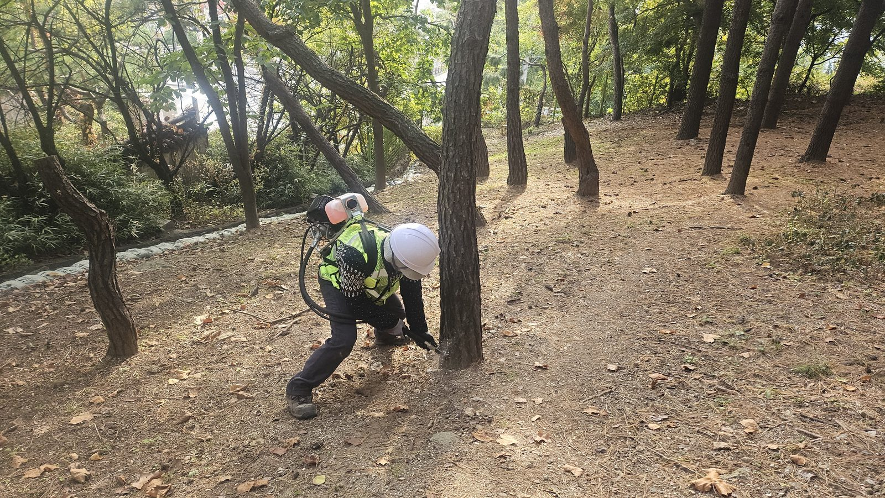
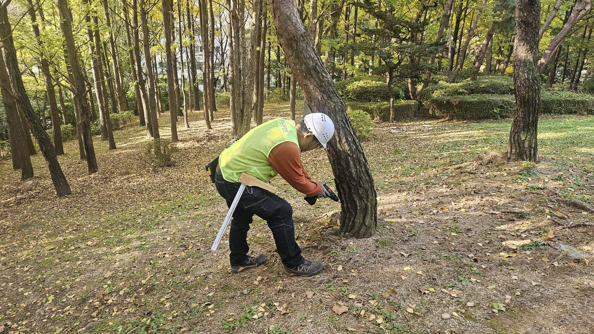
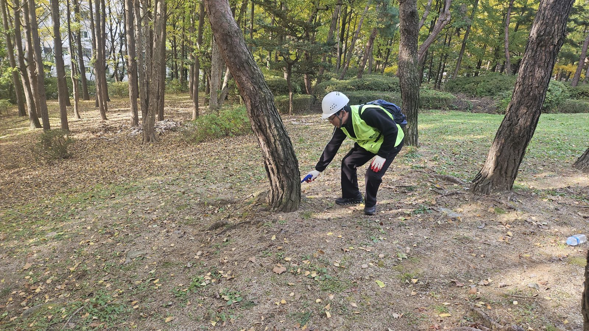
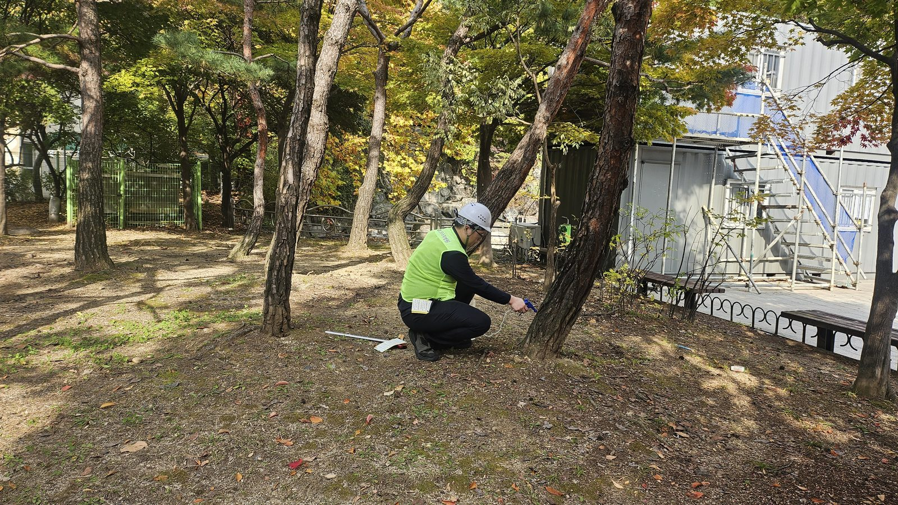
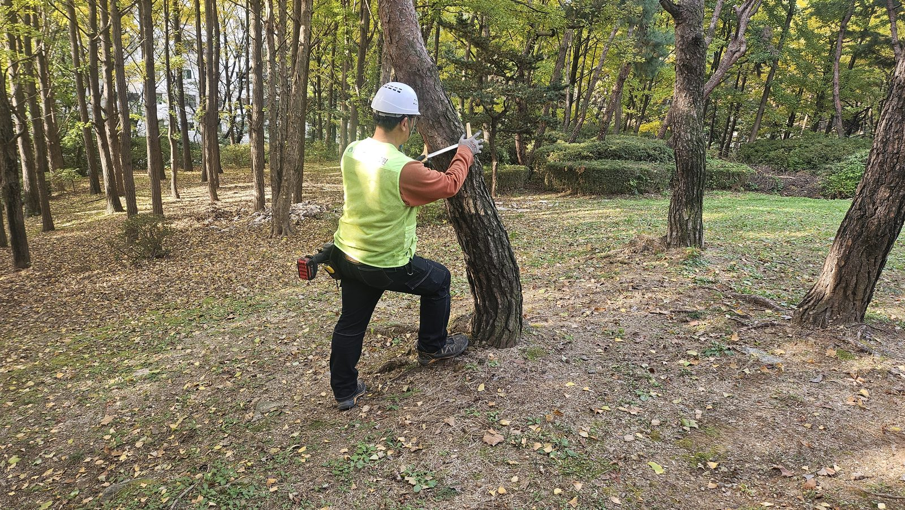

## 공사 개요

| 구분           | 내용                                                                         |
| -------------- | ---------------------------------------------------------------------------- |
| 사업명         | 2025 수정·중원구 산림 돌발해충 방제 (발주: 성남시청)                         |
| 대상지         | 성남시 수정구·중원구 관내 공원 소나무류 (희망대공원 일대 구역 포함)          |
| 작업 시기      | 2025년 11월 — 매개충 활동기 이전 예방주사 적기                               |
| 작업 내용      | 구역별 대상목 확인, 흉고직경 측정, 밑동 천공, 소나무재선충병 예방나무주사    |
| 투입 장비      | 직경자·윤척, 충전 드릴, 배부식 엔진 천공기, 나무주사 주입기, 작업 구역도     |

공원 소나무는 산림 소나무와 사정이 다릅니다. 한 그루 한 그루가 경관의 중심이고, 바로 옆으로 산책로와 벤치, 놀이시설이 지나갑니다. 소나무재선충병에 한 번 감염되면 **회복시킬 방법이 없고 베어 내는 것 외에는 처리 수단이 없습니다.** 그래서 공원 소나무의 재선충 대비는 감염된 뒤가 아니라, 매개충이 활동하기 전에 약제를 미리 나무 안에 넣어 두는 **예방나무주사**로 합니다.

---

## 구역도부터 그립니다

산림에는 임반·소반이라는 정해진 구획이 있지만, 도심 공원에는 그런 단위가 없습니다. 그래서 작업 전에 **항공사진 위에 구역을 직접 그리고 번호를 매겼습니다.** 소나무가 모여 있는 군락을 기준으로 1번부터 7번까지 나누고, 면적이 큰 구역은 7-1처럼 세분했습니다.

- 구역 번호 순서대로 작업 동선을 잡아, 같은 곳을 두 번 돌거나 빠뜨리는 나무가 없게 합니다.
- 작업자가 여러 조로 나뉘어도 도면 한 장으로 진행 상황을 맞출 수 있습니다.
- 준공 보고 때 구역별 시행 내역을 그대로 정리할 수 있습니다.

---

## 약량은 나무마다 다릅니다 — 흉고직경 측정

예방나무주사의 약량은 **흉고직경(지상 1.2m 높이의 줄기 지름)** 에 따라 정해집니다. 약제가 수관 전체로 퍼져야 효과가 나므로, 줄기가 굵을수록 넣어야 할 양도 늘어납니다. 같은 공원 안에서도 수십 년 된 노송과 근래 식재한 소나무가 섞여 있어, 눈대중으로 일괄 주입하면 큰 나무는 부족하고 작은 나무는 과하게 됩니다.

그래서 **한 그루씩 직경을 재고, 그 자리에서 기록**합니다. 측정값이 곧 그 나무의 주입량이자 천공 개수의 근거가 됩니다.

계단 옆 비탈처럼 접근이 불편한 자리의 소나무도 건너뛰지 않습니다. 대상목 누락은 그대로 방제 공백이 됩니다.

---

## 밑동 천공 — 약제가 머무를 자리를 만듭니다

주입 구멍은 줄기 **밑동 가까이**에 냅니다. 드릴은 아래쪽으로 비스듬히 넣어, 주입한 약액이 구멍 밖으로 흘러나오지 않고 고이도록 합니다. 직경이 큰 나무는 구멍을 줄기 둘레에 나눠 뚫어 약제가 한쪽 방향으로만 올라가지 않게 합니다.

장비는 **충전 드릴과 배부식 엔진 천공기를 함께** 운용했습니다. 엔진 천공기는 배터리 교체 없이 연속 천공이 가능해, 대상목이 몰려 있는 구역에서 작업 속도를 유지할 수 있습니다.

측정 도구를 몸에 지닌 채 측정 → 천공을 한 사람이 이어서 하면, 나무 사이를 오가는 동선이 줄고 직경 기록과 천공 개수가 어긋나는 일도 막을 수 있습니다.

---

## 주입 — 뿌리지 않으니 날리지 않습니다

천공을 마친 구멍에 주입기 노즐을 밀착해, 직경으로 산정한 양만큼 약액을 넣습니다. 들어간 약제는 줄기의 수분 이동을 따라 가지와 잎까지 퍼집니다. 이후 매개충(솔수염하늘소·북방수염하늘소)이 잎과 새 가지를 갉아 먹으며 재선충을 옮기더라도, 나무 안에 퍼져 있는 약제가 재선충의 증식을 억제하는 원리입니다.

공원에서 나무주사가 유리한 이유는 **약제가 공기 중으로 날리지 않는다**는 점입니다. 수관 살포였다면 벤치와 시설물 주변을 넓게 통제해야 했겠지만, 나무주사는 작업 중인 나무 주변만 비켜 주면 됩니다. 이용객이 오가는 평일 낮에도 공원 이용을 막지 않고 작업할 수 있었습니다.

---

## 시공 결과

구역도에 표시한 공원 소나무 군락을 번호 순서대로 돌며, 대상목마다 **직경 측정 → 천공 → 정량 주입**을 마쳤습니다. 매개충이 활동을 시작하는 늦봄 이전에 약제가 수체 안에 충분히 퍼지도록 11월에 시행했습니다.

**💡 나무의사의 관리 팁**

예방나무주사는 **건강한 나무에 놓는 것**입니다. 이미 잎이 붉게 변하고 송진이 나오지 않는 나무는 주사로 되살릴 수 없고, 오히려 감염 의심목으로 관할 기관에 신고해야 합니다. 공원 소나무를 관리하신다면 주사 시행 전 대상목의 상태를 먼저 확인하고, 약제별 재시행 주기에 맞춰 다음 회차를 미리 계획해 두시기 바랍니다. 구역도와 직경 기록을 남겨 두면 다음 회차의 물량 산정과 예산 편성이 훨씬 수월해집니다.

---

## 시공·진단 의뢰 문의

**느티나무병원 협동조합** — 산림청 등록 1종 나무병원 · 조경식재공사업

- 전화 **031-752-6000**
- 팩스 031-752-6001
- 이메일 coopneuti@naver.com
- 본점 경기도 성남시 수정구 태평로 104

공원·녹지 소나무의 재선충병 예방나무주사는 나무의사가 대상목 상태를 확인한 뒤, 흉고직경 측정에 따라 약량을 산정해 시행합니다. 구역도 작성, 대상목 기록, 시행 사진대지까지 준공 서류로 정리해 드립니다. 지자체·관공서 **수의계약**은 실적증명서와 자격·면허 증빙을 견적서와 함께 제공합니다.

_(본 게시물의 사진은 모두 실제 시공 현장에서 촬영한 것입니다.)_
