## 공사 개요

| 구분      | 내용                                                                                   |
| --------- | -------------------------------------------------------------------------------------- |
| 대상지    | 개인 주택 정원·마당 소나무                                                             |
| 작업 시기 | 2026년 10월 30일 실측, 11월 12일 주입, 11월 13일 마개·도포 — 매개충 우화 이전          |
| 작업 내용 | 흉고둘레 실측·약량 산정, 수간 천공, 주입병 설치, 마개·도포 처리, 시행목 표찰 부착      |
| 사용 약제 | 아세타미프리드·에마멕틴벤조에이트 액제 16% (산림청 등록 나무주사 약제, 4년 1회)        |
| 투입 장비 | 줄자, 충전 드릴, 약제 주입병, 마개, 도포제, 표찰                                        |

수십 년 키운 정원 소나무는 한 그루가 정원의 얼굴입니다. 소나무재선충병은 한 번 감염되면 살릴 수 없기 때문에, 할 수 있는 일은 **매개충이 나오기 전에 건강한 소나무 안에 약제를 넣어 두는 것**입니다. 늦가을 실측을 거쳐 11월, 정원과 마당의 소나무에 예방나무주사를 시행했습니다.

---

## 줄기 둘레를 재서 약량을 정합니다

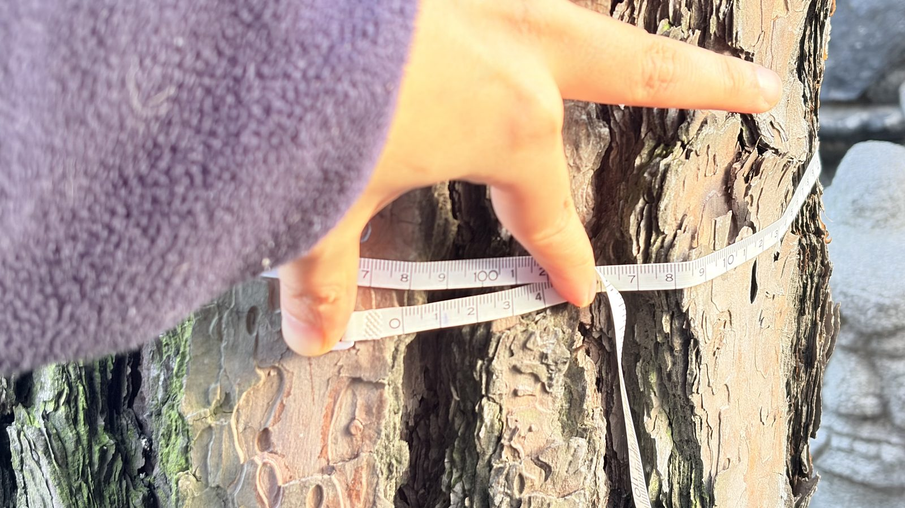

사용한 약제는 **흉고직경(지상 1.2m 높이의 줄기 지름) 1cm당 원액 1mL**를 넣도록 정해져 있습니다. 정원 소나무는 줄기가 굽고 옆에 돌담·석물이 붙어 있어 윤척을 대기 어려운 경우가 많습니다. 그래서 **줄자로 둘레를 재고 지름으로 환산**했습니다(둘레 ÷ 3.14).

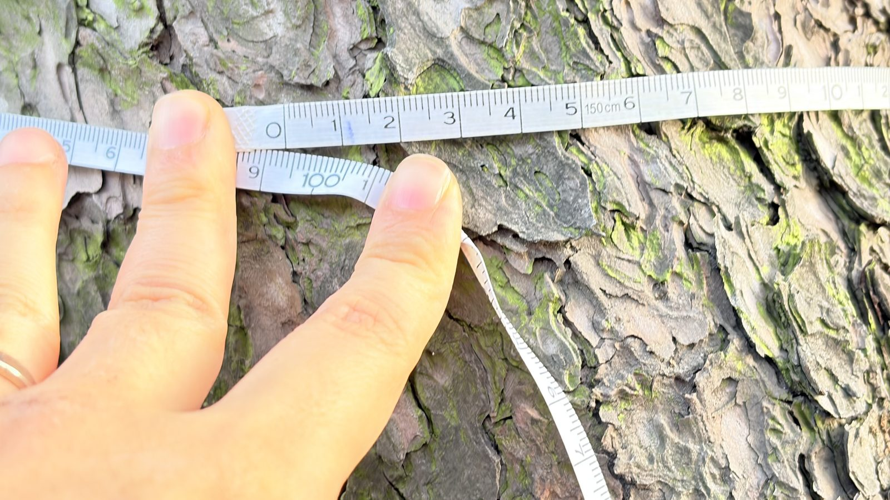

예를 들어 둘레가 94cm인 소나무는 지름이 약 30cm이므로 원액 30mL가 들어갑니다. 실측은 주입 2주 전에 미리 해 두고, 나무마다 필요한 주입병 수를 계산해 두었습니다.

---

## 주입병을 줄기 둘레에 나눠 꽂습니다

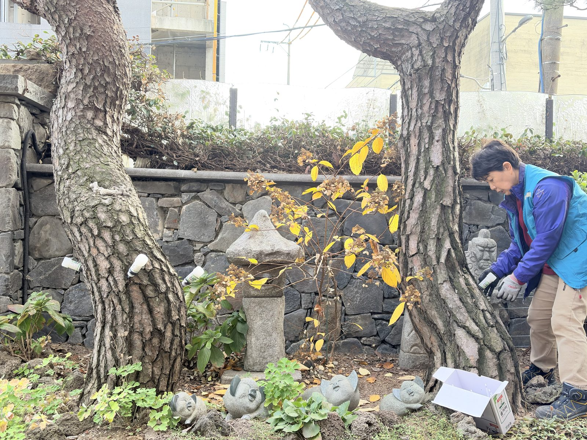

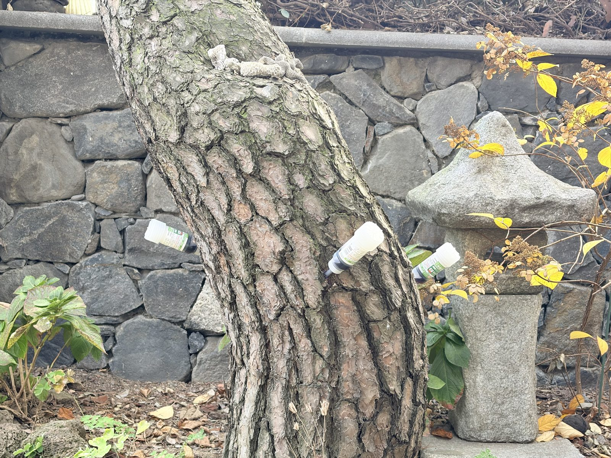

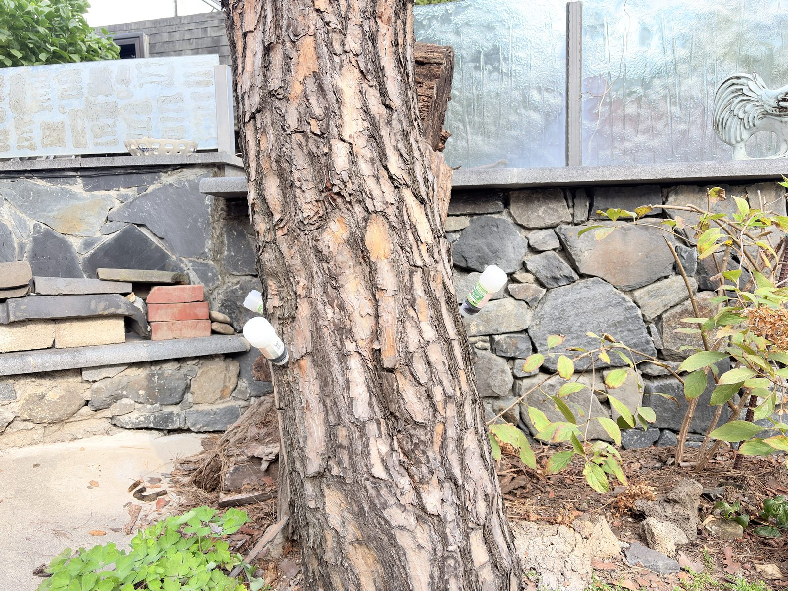

계산한 약량을 **주입병 여러 개로 나눠 줄기 둘레에 고르게** 꽂습니다. 약제는 줄기의 물길을 타고 올라가는데, 한쪽 면에만 넣으면 반대편 가지까지 약효가 고르게 닿지 않기 때문입니다. 주입병은 천공한 구멍에 꽂아 두면 나무가 약액을 스스로 빨아들이는 **흡수식(중력식)** 입니다. 약값이 경제적이지만 날씨와 나무 컨디션(특히 송진)에 따라 흡수 속도가 달라지므로, 하루를 두고 다음 날 병을 회수했습니다.

---

## 장독대 옆, 창고 옆 소나무도 그대로

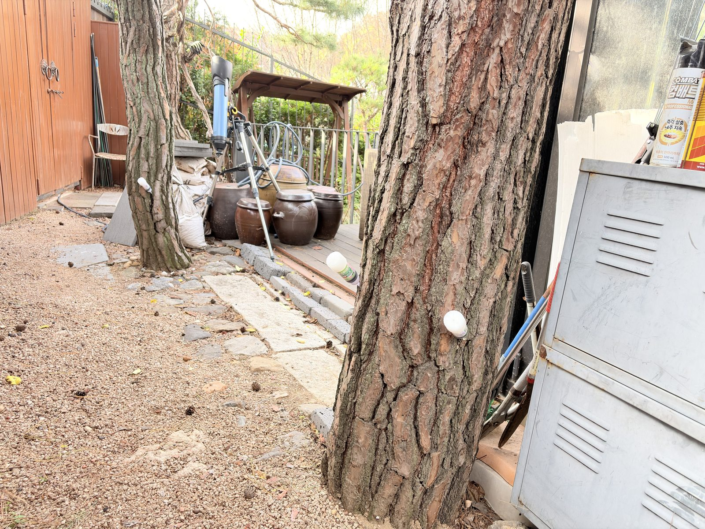

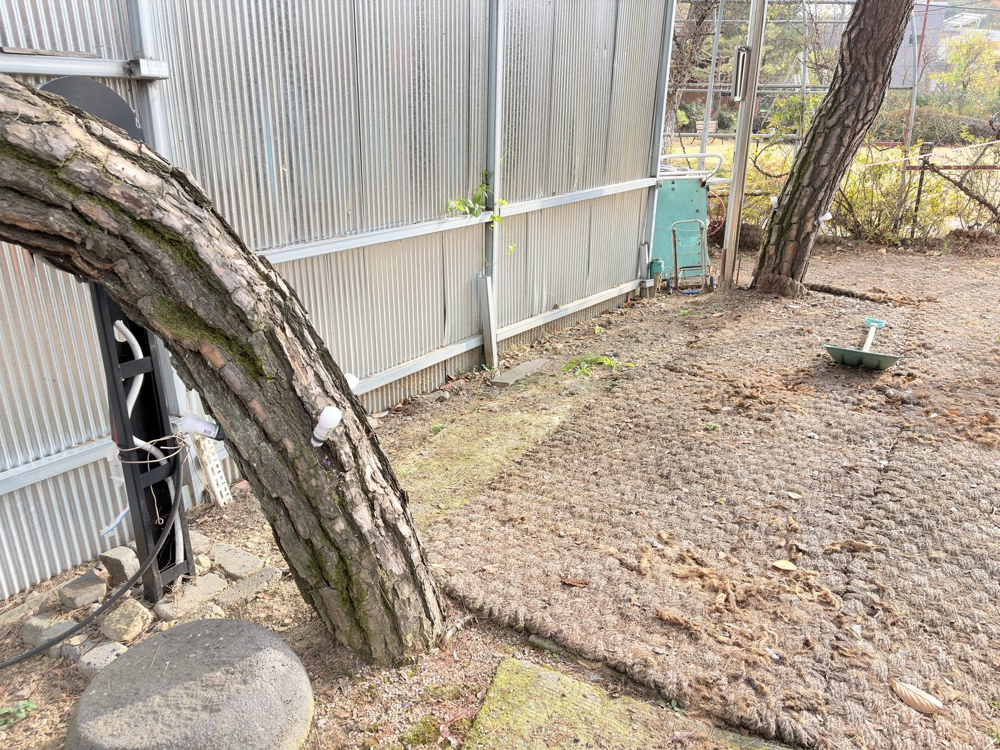

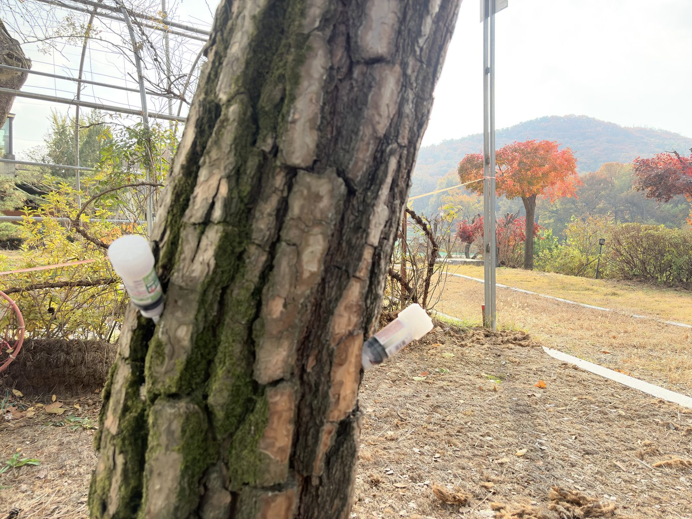

마당의 소나무는 장독대·창고·비닐하우스 바로 옆에 서 있습니다. 약제를 뿌리는 방제였다면 살림살이를 덮고 치워야 했겠지만, 나무주사는 **약제를 줄기 안에 직접 넣기 때문에 공기 중으로 날리지 않습니다.** 생활공간을 그대로 둔 채 작업했습니다.

---

## 산림청 등록 약제를 씁니다

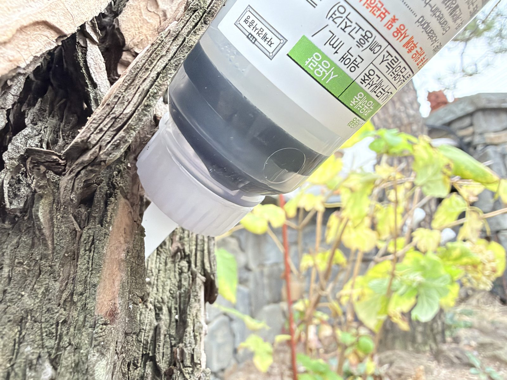

사용한 약제는 **아세타미프리드(10)·에마멕틴벤조에이트(6) 액제 16%** 입니다. 라벨의 적용해충에 소나무재선충과 매개충인 솔수염하늘소가 함께 적혀 있습니다. 재선충과 매개충을 함께 막는 혼합제로, 산림청 「소나무재선충병 예방방법」의 나무주사 약제 목록에 **4년 1회** 시행 약제로 올라 있습니다.

---

## 주입을 마치면 구멍을 막습니다

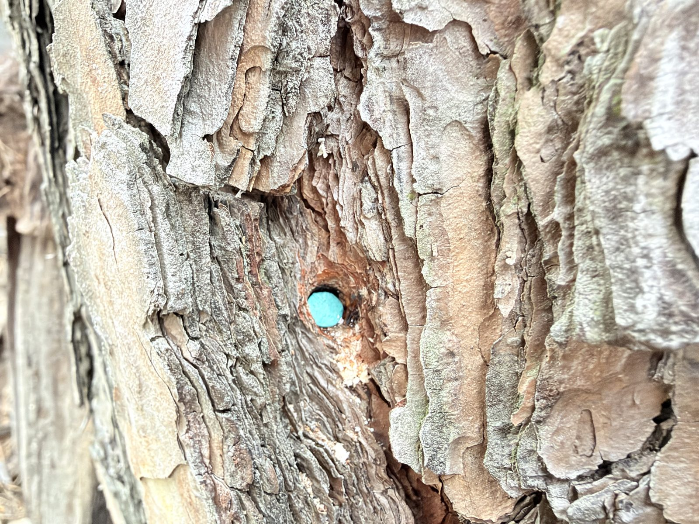

다음 날 약액이 모두 흡수된 것을 확인하고 주입병을 뺀 뒤, 구멍에는 **마개**를 끼웁니다. 구멍을 열어 두면 빗물과 부후균이 들어가 줄기 안쪽이 썩을 수 있습니다.

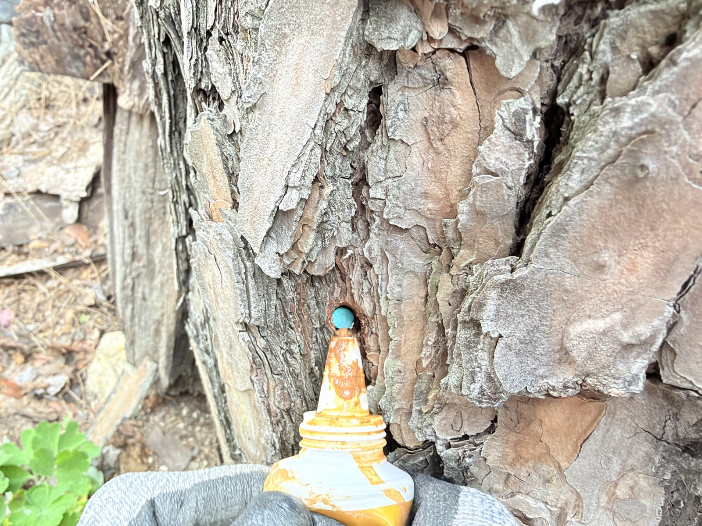

마개 둘레에는 **도포제**를 발라 틈을 메웁니다. 상처 부위가 마르고 아무는 동안 병원균이 들어가지 않게 하는 마무리입니다.

---

## 시행목 표찰을 남깁니다

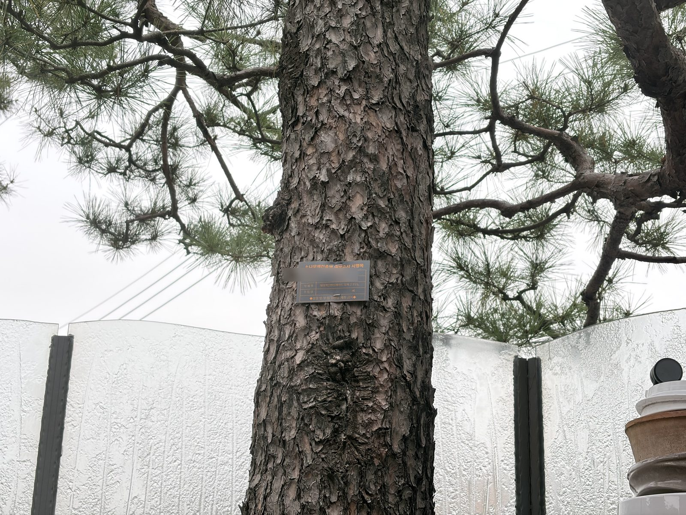

주사를 놓은 소나무에는 **시행목 표찰**을 붙입니다. 표찰 하단의 '솔잎 및 잣 등 임산물 채취 금지' 문구처럼, 약제를 넣은 나무의 솔잎과 열매는 채취하지 않아야 합니다. 이 기록이 4년 뒤 다음 회차 시기를 정하는 근거가 됩니다.

---

## 시공 결과

정원과 마당의 소나무에 **둘레 실측 → 약량 산정 → 천공·주입병 설치 → 마개·도포 → 표찰 부착**을 마쳤습니다. 매개충이 우화하는 이듬해 4~5월 전에 약제가 줄기와 가지로 퍼질 시간을 확보했습니다.

**💡 나무의사의 관리 팁**

예방나무주사는 감염된 나무를 고치는 치료가 아니라 **건강한 나무를 지키는 예방**입니다. 주사 뒤에도 잎이 갑자기 처지거나 붉게 변하는 소나무가 보이면, 임의로 베거나 옮기지 말고 바로 연락 주시기 바랍니다. 주변에 말라 죽은 소나무나 쌓아 둔 소나무 장작이 있으면 매개충이 알을 낳는 곳이 되므로 함께 정리하는 것이 좋습니다. 이번 약제는 4년 1회 시행 약제이므로, 표찰의 시행 시기를 기준으로 다음 회차를 계획하시면 됩니다.

---

## 시공·진단 의뢰 문의

**느티나무병원 협동조합** — 산림청 등록 1종 나무병원 · 조경식재공사업

- 전화 **031-752-6000**
- 팩스 031-752-6001
- 이메일 coopneuti@naver.com
- 본점 경기도 성남시 수정구 태평로 104

개인 주택 정원, 아파트 단지, 학교·공원의 소나무 예방나무주사를 시행합니다. 나무의사가 대상목 상태를 확인하고 흉고직경으로 약량을 산정하며, 산림청 등록 약제만 사용합니다. 잎이 붉어진 의심목은 시료를 채취해 당일 진단 결과를 알려 드립니다.

_(본 게시물의 사진은 모두 실제 시공 현장에서 촬영한 것입니다.)_
