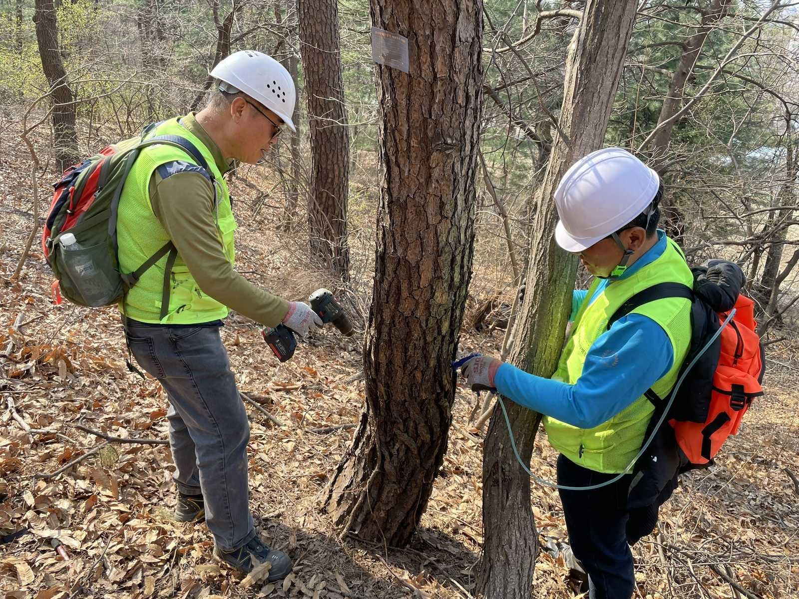
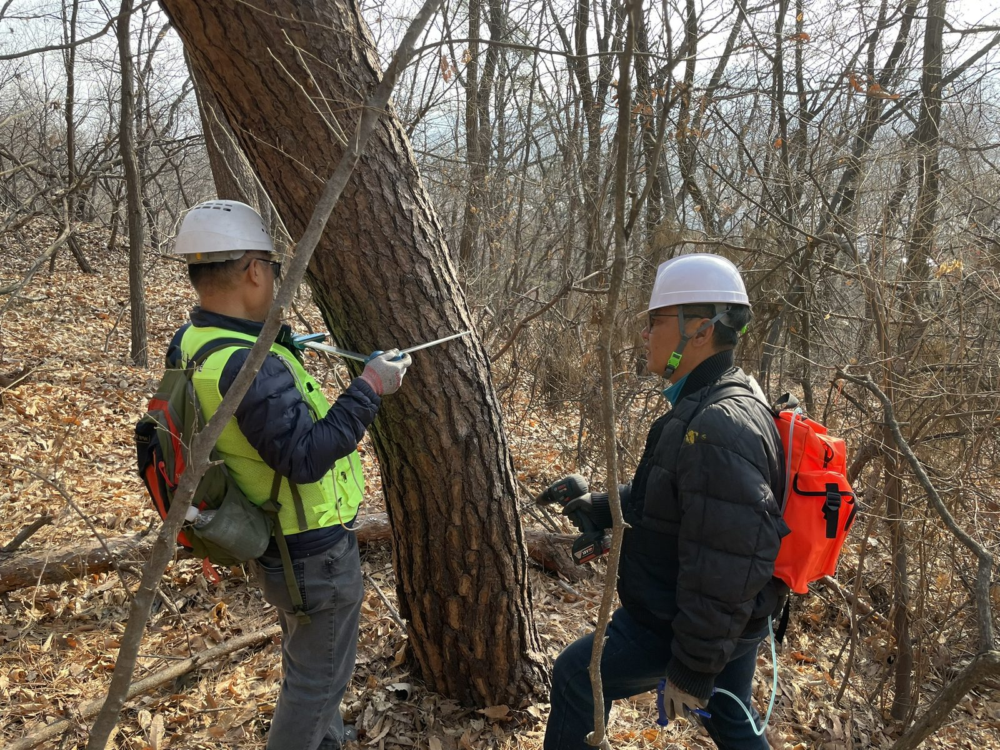
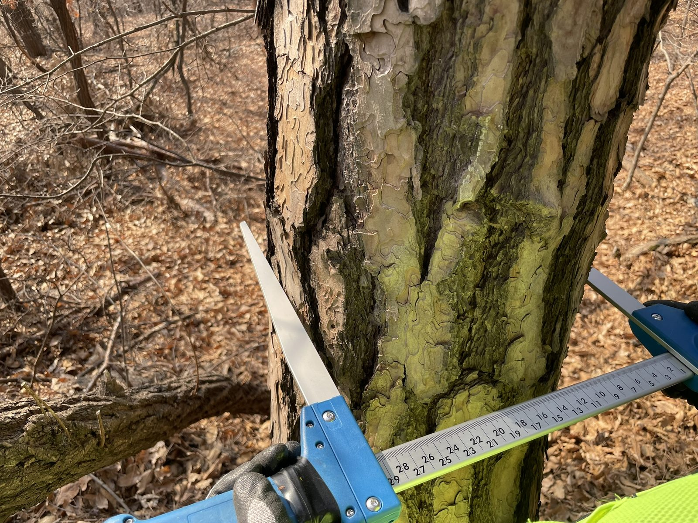
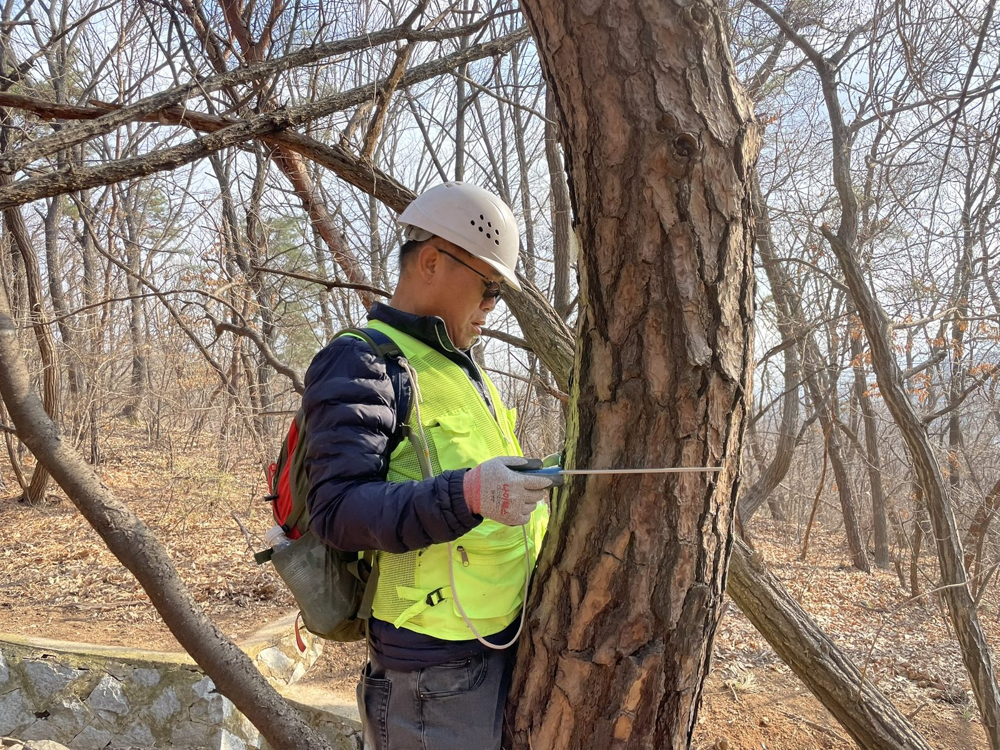
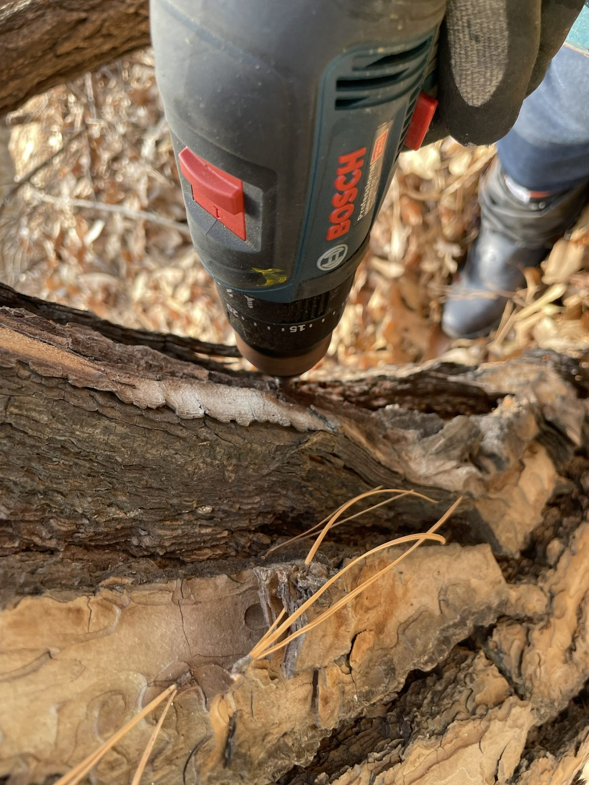
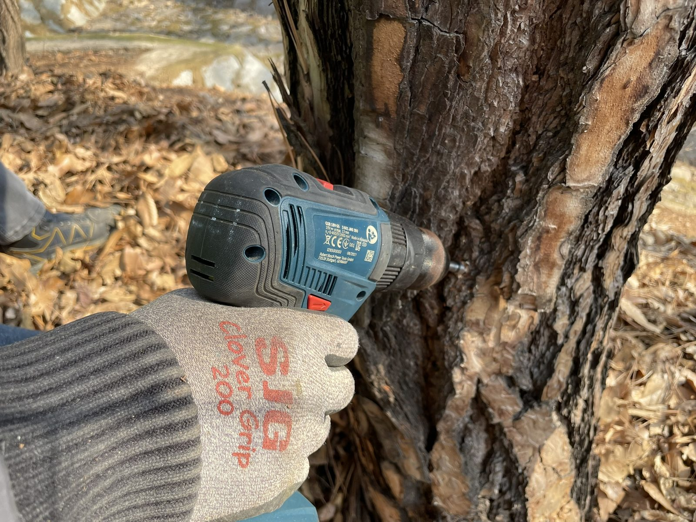
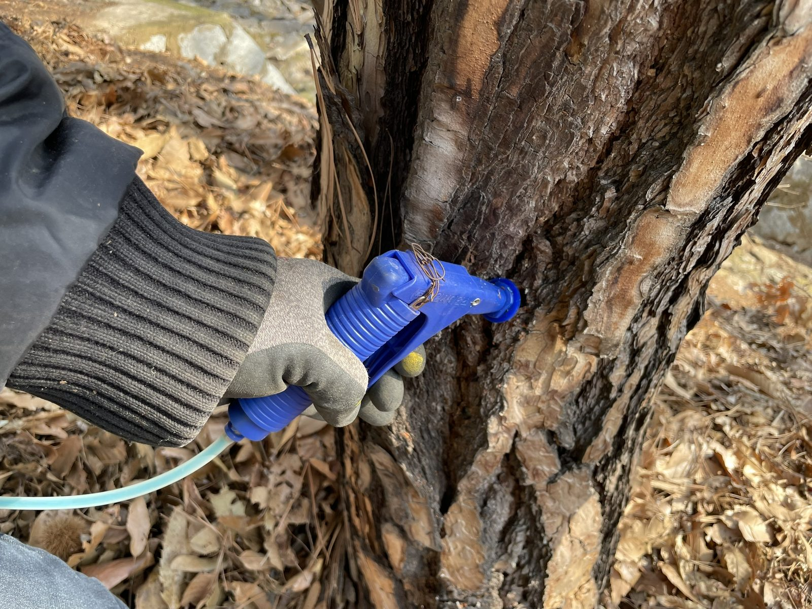
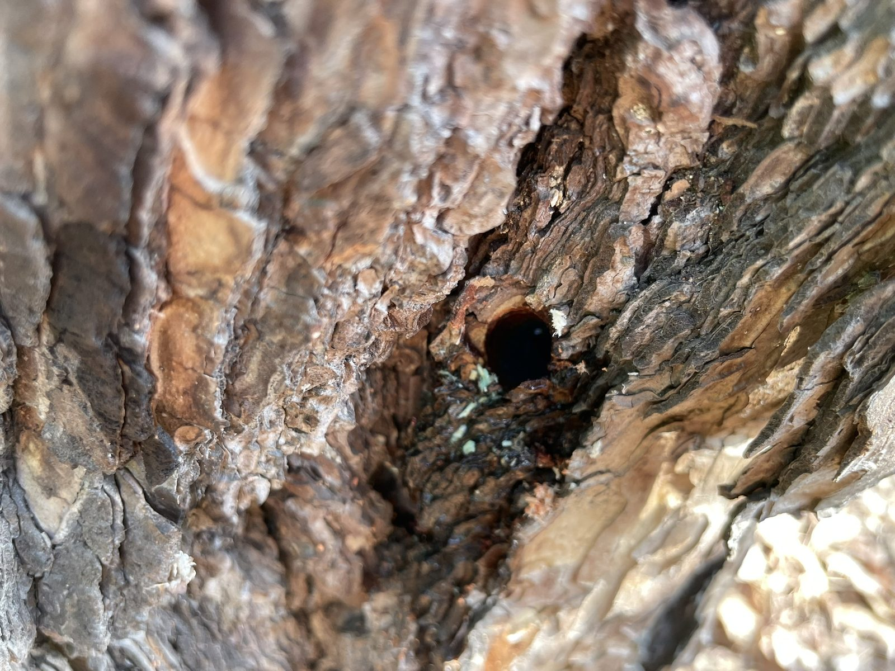
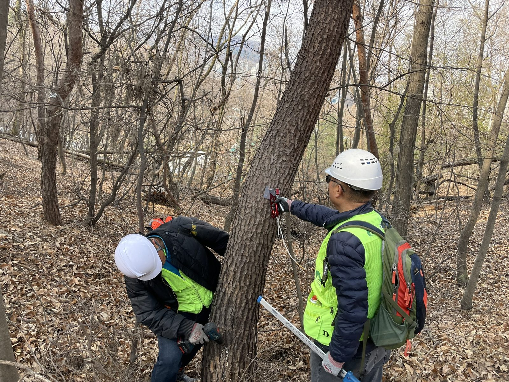
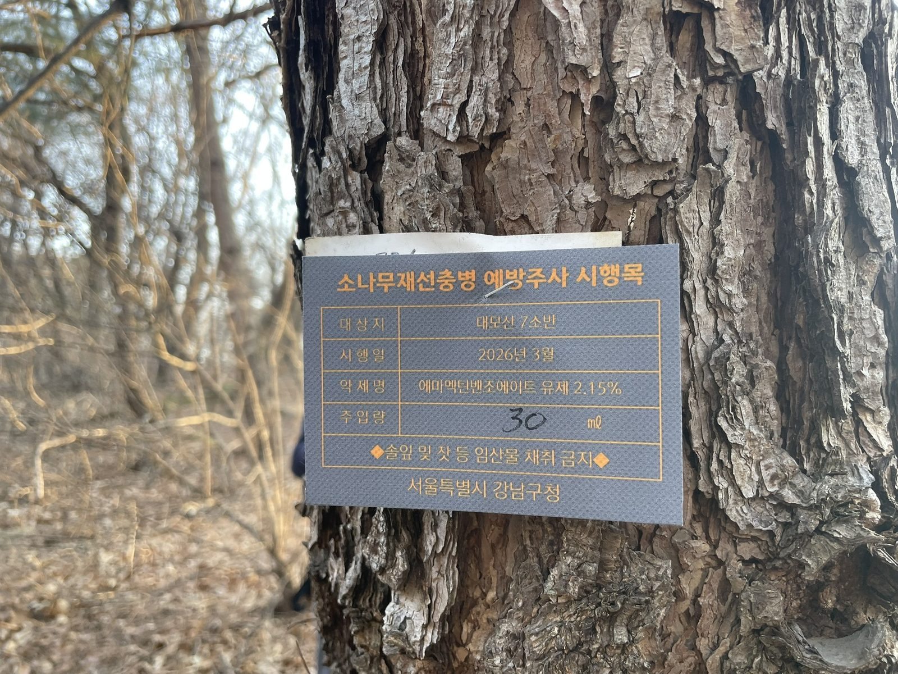

## 공사 개요

| 구분           | 내용                                                                          |
| -------------- | ----------------------------------------------------------------------------- |
| 대상지         | 서울 강남구 대모산·구룡산 일대 산림 소나무류 (대모산 7소반 등)                |
| 발주처         | 서울특별시 강남구청                                                           |
| 작업 시기      | 2026년 3월 — 매개충 우화 이전                                                 |
| 작업 내용      | 흉고직경 측정, 밑동 천공, 예방나무주사 약제 주입, 시행목 표찰 부착           |
| 사용 약제      | 에마멕틴벤조에이트 유제 2.15% (표찰 기재 기준)                                |
| 투입 장비      | 윤척, 충전 드릴, 약액 배낭·호스 연결 주입기, 표찰·타카                        |

2026년 1월, 대모산과 이어진 구룡산에서 소나무재선충병 감염이 확인됐습니다. 재선충은 매개충인 솔수염하늘소·북방수염하늘소를 타고 옮겨 가고, 감염된 소나무는 살릴 수 없습니다. 인접한 숲에서 할 수 있는 일은 **매개충이 나오기 전에 건강한 소나무 안에 약제를 넣어 두는 것**입니다. 강남구청 발주로 3월, 대모산·구룡산 일대 소나무류에 예방나무주사를 시행했습니다.

---

## 2인 1조 — 재는 사람, 뚫고 넣는 사람

산림 구간은 공원과 달리 대상목이 경사지에 흩어져 있고, 나무 사이 이동에 시간이 많이 듭니다. 그래서 **두 사람이 한 조로 한 나무에서 모든 공정을 끝내고** 다음 나무로 넘어가는 방식으로 작업했습니다.

한 사람이 직경을 재서 주입량을 부르면, 다른 사람이 바로 천공하고 주입합니다. 약액은 **등에 멘 배낭 탱크에서 호스로 주입기까지 연결**되어 있어, 나무마다 약통을 열고 덜어 낼 필요가 없습니다. 산비탈에서 약제를 옮겨 붓는 과정이 사라지니 약액이 땅에 흘릴 일도 줄어듭니다.

---

## 흉고직경을 재서 주입량을 정합니다

예방나무주사의 약량은 **흉고직경(지상 1.2m 높이의 줄기 지름)** 에 비례합니다. 윤척을 줄기 양쪽에 대어 직경을 읽고, 그 값으로 그 나무의 주입량과 천공 개수를 정합니다. 직경이 작은 나무에 과량을 넣으면 약해 위험이 있고, 큰 나무에 부족하게 넣으면 수관 끝까지 약제가 닿지 않습니다.

대모산·구룡산은 등산객이 많은 산입니다. 등산로 바로 옆의 소나무부터 능선 비탈의 소나무까지, 대상목은 한 그루씩 직접 찾아가 잽니다.

---

## 밑동 천공 — 아래로 비스듬히

주입 구멍은 줄기 밑동에, **아래쪽으로 비스듬히** 뚫습니다. 구멍이 아래로 기울어 있어야 주입한 약액이 밖으로 흘러나오지 않고 구멍 안에 머물렀다가 줄기로 흡수됩니다.

직경이 큰 나무는 구멍을 줄기 둘레에 나눠 냅니다. 약제가 한쪽 면으로만 올라가면 반대편 가지에는 약효가 닿지 않기 때문입니다.

---

## 주입 — 정량을 구멍에 바로

천공 직후 주입기 노즐을 구멍에 밀착해 정해진 양을 넣습니다. 들어간 약제는 줄기의 수분 이동을 타고 가지와 잎까지 퍼집니다. 5월 이후 매개충이 우화해 새 가지를 갉아 먹으며 재선충을 옮기더라도, 나무 안의 약제가 재선충의 증식을 억제합니다. 3월은 매개충이 우화하기 전으로, **약제가 수관 끝까지 퍼질 시간을 확보할 수 있는 시기**입니다.

주입이 끝나면 구멍 주변을 확인해 약액이 밖으로 새어 나오지 않았는지 봅니다.

---

## 시행목마다 표찰을 남깁니다

표찰은 작업 중인 나무에 그 자리에서 박습니다. 한 사람이 천공하는 동안 다른 사람이 **시행목 표찰**을 붙이면, 작업 시간이 늘지 않으면서도 어느 나무까지 주사를 마쳤는지 현장에서 바로 구분됩니다.

표찰에는 **대상지(소반), 시행월, 약제명, 주입량**이 들어갑니다. 주입량은 나무마다 직경으로 산정한 값이 다르기 때문에 현장에서 손으로 적습니다. 이 기록이 다음 회차 시행 시기와 대상목을 판단하는 근거가 됩니다.

표찰 하단의 **'솔잎 및 잣 등 임산물 채취 금지'** 문구도 중요합니다. 약제를 주입한 나무의 잎과 열매는 채취해서는 안 되는데, 등산객이 많은 산에서는 이 사실을 나무에 직접 알리는 것이 가장 확실한 방법입니다.

---

## 시공 결과

대모산·구룡산 일대 대상 소나무류에 2인 1조로 **직경 측정 → 천공 → 정량 주입 → 표찰 부착**을 마쳤습니다. 시행목에는 모두 약제명과 주입량을 기록한 표찰을 남겨, 발주처가 현장에서 시행 여부를 직접 확인할 수 있도록 했습니다.

**💡 나무의사의 관리 팁**

예방나무주사는 감염목 치료가 아니라 **건강한 나무를 지키는 예방**입니다. 잎이 짧은 기간에 붉게 변하고 송진이 나오지 않는 소나무가 보이면 주사를 놓을 것이 아니라, 임의로 베거나 옮기지 말고 관할 기관에 신고해야 합니다(「소나무재선충병 방제특별법」). 인접 지역에서 감염이 확인된 숲이라면 예방주사와 함께 의심목 예찰을 병행하고, 표찰과 시행 기록을 바탕으로 약제별 재시행 주기에 맞춰 다음 회차를 계획하시기 바랍니다.

---

## 시공·진단 의뢰 문의

**느티나무병원 협동조합** — 산림청 등록 1종 나무병원 · 조경식재공사업

- 전화 **031-752-6000**
- 팩스 031-752-6001
- 이메일 coopneuti@naver.com
- 본점 경기도 성남시 수정구 태평로 104

소나무재선충병 예방나무주사는 나무의사가 대상목 상태를 확인하고, 흉고직경에 따라 약량을 산정해 시행합니다. 시행목 표찰 부착, 대상목 기록, 작업 사진대지까지 준공 서류로 정리해 드립니다. 지자체·관공서 **수의계약**은 실적증명서와 자격·면허 증빙을 견적서와 함께 제공합니다.

_(본 게시물의 사진은 모두 실제 시공 현장에서 촬영한 것입니다.)_
